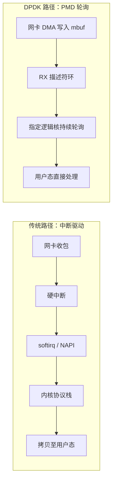
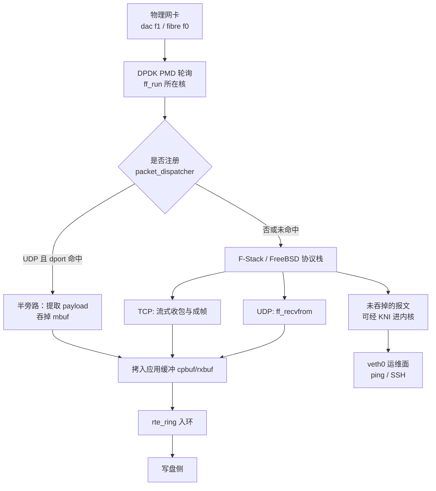
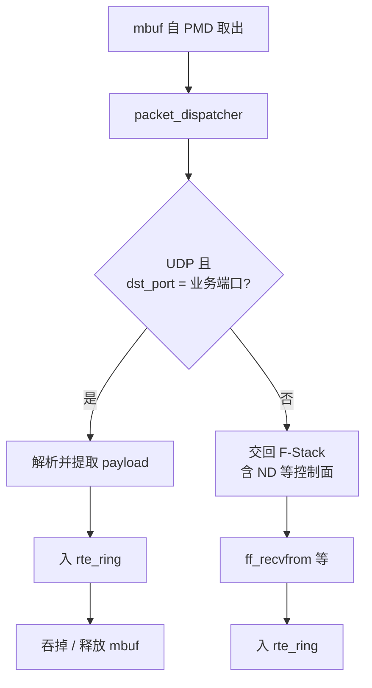
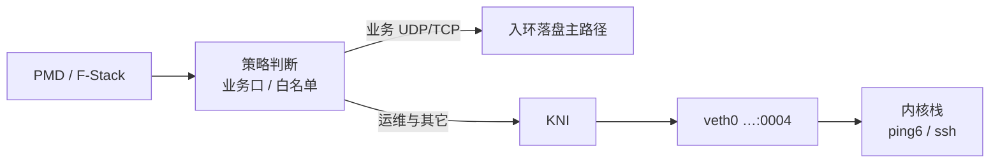
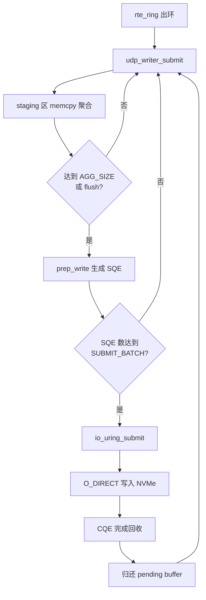

# 面向万兆链路的用户态收包与异步落盘系统——衔接说明稿

> **定位说明：** 本文按论文体例组织，供项目复盘与后续同学接手阅读；非投稿定稿。数据与结论以工程实测为准，细节命令见 [command.md](../command.md)，版本沿革见 [迭代计划.md](./迭代计划.md)，完整测表见 [性能统计.md](./性能统计.md)。  
> **工程载体：** `Fstack-DPDk_8004`（常作收端）与对端 `Fstack-DPDk`；落盘对照基线为同写盘库的 `UDP_DPDK/`。

---

# 预备知识

本章介绍本系统所依赖的三类基础技术：数据平面开发套件 DPDK、用户态协议栈 F-Stack，以及 Linux 异步 I/O 接口 io_uring。理解它们在「收包—转发—落盘」路径上各自承担的职责，是理解后续优化动机与架构取舍的前提。

## DPDK

传统 Linux 网络路径以中断驱动为核心：网卡收到报文后发起硬中断，内核再调度软中断（softirq / NAPI）完成收包、协议解析与投递。报文通常先由 DMA 写入内核 sk_buff，再沿驱动、协议栈与套接字缓冲逐层处理，最终经一次或多次拷贝进入用户态应用缓冲区。即便引入 NAPI 批量轮询与 GRO 等缓解机制，该路径仍保留若干结构性开销：

* **中断与软中断调度**：每批报文仍可能伴随硬中断与 softirq 调度，调度本身即占用 CPU 时间片。
* **跨上下文切换**：协议栈与应用分属不同执行上下文，频繁切换会冲刷流水线与缓存。
* **sk_buff 元数据开销**：锁、引用计数与缓冲管理抬高每包成本。
* **多次数据拷贝**：内核到用户态的拷贝额外消耗内存带宽。

在千兆以下，这些开销往往可被 CPU 余量掩盖；一旦链路达到万兆乃至更高速率，包到达间隔缩短到微秒量级，上述因素叠加放大，使「内核收包—投递用户态」本身成为吞吐天花板，应用侧再优化 socket 读取也难以突破。

DPDK（Data Plane Development Kit）正是针对上述瓶颈而设计：它将网卡从内核驱动中解绑，改由用户态轮询模式驱动直接访问 DMA 描述符与报文缓冲，从而把**"取包"** 变成应用线程可完全控制的紧循环，绕开中断驱动与内核协议栈上的逐层开销。

### PMD 轮询

PMD（Poll Mode Driver）是 DPDK 的核心工作方式。与「中断到来再处理」不同，绑定到指定逻辑核的线程持续轮询网卡接收队列上的描述符：一旦硬件将报文写入预先注册的内存，软件便可在用户态立即看到并处理，而无需陷入内核。这种模式以持续占用 CPU 为代价换取极低的每包开销与稳定的吞吐上界，因此适合作为高速数据面的收包引擎，而不适合与桌面交互类负载共享同一逻辑核。一种常见的**丢包**原因则为PMD轮询速度不够，RX队列的取出速度不及DMA注入的速度

### 内存池

高速收包路径几乎不允许在热路径上频繁调用通用堆分配器。DPDK 为此提供基于大页的内存池（mempool）：报文以 mbuf 为基本单位预先分配（内存池的单个元素），收包时仅从池中取空闲对象，处理完毕后归还。**池的深度决定了「在途报文」可缓冲的上限**；池耗尽时，新到达的报文无法再被软件接管，这是丢包的另一重要成因。

本工程在 mbuf 之外，还维护应用层的描述符池与载荷缓冲池（如 cpbuf / rxbuf）。其设计意图是：协议解析完成后，尽快将有效载荷拷出 mbuf，使 mbuf 能迅速回到网卡侧供 DMA 复用，从而降低「慢消费者拖死快速生产者」的风险。需要强调的是，应用层缓冲打满与网卡 RX 环溢出是两类不同故障：前者通常表现为 `Buffer drops`、缓冲池占用峰值触及上限；后者往往在应用计数器仍近似为零时，已在驱动统计中出现 `imissed`。接手调试时，必须同时观察这两层指标，否则容易将「收包核来不及取包」误判为「写盘或应用逻辑出错」。

### 无锁队列

当收包与写盘被拆到不同逻辑核时，二者之间需要一条低开销、可背压的通道。本系统采用 DPDK 提供的单生产者—单消费者无锁环（`rte_ring`）：收包侧将已解析的载荷描述符入环，写盘侧批量出环并提交异步写。无锁结构避免了互斥锁带来的抖动，但其容量仍然有限——环满时，生产者只能短暂自旋等待或丢弃。短暂自旋用于吸收写盘完成延迟的尖峰；若写盘持续慢于入向速率，等待会传导至上游，最终表现为缓冲池堆积乃至网卡丢包。

因此，无锁队列在架构上的意义不仅是「解耦」，更是把系统从「单线程同步流水线」改造成「带弹性缓冲的两级流水线」。后文性能优化中的许多定量结论，都建立在「环与池的峰值是否被打满」这一可观测事实上：峰值长期接近容量，说明下游跟不上；峰值很低且仍出现 `imissed`，则瓶颈更可能在收包核本身的处理能力。

## F-Stack

纯 DPDK 应用可以逼近线速，但往往需要自行实现或裁剪协议处理，难以自然支持完整的 TCP、邻居发现以及与内核运维面的共存。F-Stack 将 FreeBSD 网络协议栈移植到 DPDK 数据平面之上，使应用程序能够以接近 BSD socket 的接口（如 `ff_recvfrom`）在用户态完成协议处理，同时继续享受 PMD 轮询带来的吞吐优势。本工程选择 F-Stack，正是为了在「高性能收包」与「协议完备 / 可运维」之间取得工程上可交付的折中；与之对照的 `UDP_DPDK` 工程则代表「极致收包、协议自研解析」的另一端。

### FreeBSD——TCP 协议栈

* **功能**

F-Stack 内嵌的 FreeBSD 网络栈为系统提供了完整的传输层与网络层能力。对 UDP，应用可通过 `ff_recvfrom` 取得载荷，也可在报文进入虚拟网口与套接字缓冲之前注册分发钩子，实现面向业务端口的半旁路。对 TCP，栈负责连接建立、序号与确认、拥塞与重传等状态机，应用侧再将字节流按业务帧长（本工程默认 1344 字节）切帧后送入与 UDP 相同的落盘通道。此外，IPv6 邻居发现等控制面报文仍依赖栈路径处理，这是半旁路设计中「业务快路径与控制面慢路径并存」的前提。

* **代价（重协议栈）**

完整协议栈的代价是每包路径显著变长：报文需经历链路层接入、网络层与传输层处理，并可能经过套接字缓冲的排队与拷贝，才能到达应用。实测表明，在单逻辑核、万兆网卡与约 1400 字节量级帧长条件下，F-Stack 完整 UDP 接收路径的可持续吞吐大约稳定在 6 Gbps 附近；继续提高入向速率时，丢包往往首先出现在 DPDK 网卡接收环，而非应用层无锁环——这说明此时瓶颈是「栈处理速率低于线速入包速率」，而不是落盘来不及。TCP 路径更重，双端 F-Stack 单流目前观测到约 3～3.6 Gbps 量级，且该数字强烈依赖发端实现，不能与 UDP 的 pktgen 线速结果直接横向比较。认识这一代价，是理解「为何需要半旁路」以及「TCP 优化应优先抬发端还是改多核」的关键。

### KNI

KNI（Kernel NIC Interface）用于在用户态数据平面与内核网络栈之间架设一条受控通道。启用后，未被业务路径吞掉的报文可以经虚拟设备进入内核，从而在同一块物理网卡被 DPDK 接管的情况下，仍然支持 ping、SSH 等运维操作。本工程将运维地址配置在 KNI 对应的 `veth0` 上（形如 `…:0004`），与业务地址（8004 为 `…:0003`，8007 为 `…:0002`）分离，并通过白名单 / 拒绝策略避免业务流量误入内核、或运维流量干扰测量。

KNI 解决的是「高速收包主机如何还能被运维」这一工程问题，而不是吞吐问题本身。当前 ping6 与 SSH 已完成功能验收；业务打流与运维口长时间并存的 soak 测试仍属后续工作。接手时需注意：重编带 KNI 的 F-Stack 库时头文件搜索路径必须优先指向工程配套的 DPDK 安装前缀，否则容易出现 virtio ABI 不一致类故障（详见错误日志）。

## io-uring

传统同步写盘接口（如每次 `write`）把「提交 I/O」与「等待完成」绑在同一次系统调用里：高包率下调用次数随包数线性增长，线程在等待磁盘时无法继续准备下一批请求，页缓存回写与 `fsync` 的长尾还会反向拖住上游。io_uring 的设计逻辑，是把异步 I/O 改造成与 DPDK 环队列相似的**用户态—内核共享环**：

* **提交队列（SQ）**：应用在用户态填好一批写请求的描述（文件、缓冲、偏移等），不必每填一条就立刻陷入内核。
* **完成队列（CQ）**：内核做完 I/O 后把结果写回完成环；应用通过收割完成事件获知进度，从而使提交与完成解耦。
* **批量与少陷入**：多条请求可攒齐后再一次性交给内核，摊薄系统调用成本；完成侧也可批量收割，避免逐请求阻塞等待。

其核心取舍是：用共享内存环与显式完成通知，换取「准备请求」和「等待介质」不再互相卡住，从而适合作为高包率落盘引擎。默认模式下，应用仍需适时通知内核「SQ 里已有待处理请求」；若启用 **SQPOLL**，则改由内核线程持续轮询提交队列，用户态可以进一步减少乃至避免这类提交通知，代价是额外占用一个内核轮询线程及相应功耗与调度复杂性。本工程当前**未启用 SQPOLL**——依靠用户态侧的写聚合与批量提交，写盘已能跟上万兆入向；SQPOLL 留作存储再次成为主瓶颈、或需要抠尾部延迟时的可选方向（见后文「后续开发工作」）。

本工程将全部 UDP/TCP 落盘收敛到同一写盘模块：上游只负责投递载荷与收尾刷新，模块内部再叠加写聚合、批量提交与可选的直接 I/O（绕过页缓存）。比较数字时需区分三种**速度**口径：磁盘基准工具给出介质极限；按业务包型单独压写盘模块，得到可持续写速；端到端联调给出「收包—落盘」耦合下的系统吞吐。

---

# 性能优化要点

本章按「遇到的问题 → 原因判断 → 采取的优化 → 效果与边界」叙述。优化并非一次性完成，而是沿「先解除写盘墙，再解除协议栈墙，再抬 TCP 发端」的路径迭代；对照工程 `UDP_DPDK` 始终作为 UDP 收包上限的参照系。

## 基本链路

未优化前，一条直观但脆弱的链路是：单线程（或单核）完成「PMD 取包 → 协议处理 → 同步/半同步写文件」。在低速率冒烟测试中该链路可以工作，但在接近万兆的持续负载下，任意一环的抖动都会直接表现为丢包或吞吐塌缩。现行基本链路将系统划分为两个以无锁环衔接的阶段，如下所示。

**图**

发端可以是对端 pktgen（UDP）、F-Stack 或内核 TCP 发送程序，也可以是交换板 FPGA（fibre）。收端在 dac 链路上默认由 8004 承担；fibre 仅 8007 的光口作为收端。链路层统一使用 IPv6，业务端口为 8888。理解这条基本链路后，下文的丢包分析与优化都可以映射到图中的某一跳。

## 丢包产生原因

在联调初期，最容易出现的误判是「看见 matched 不满就认定写盘有问题」。实际上，丢包可能发生在硬件接收环、应用缓冲池、无锁环或业务校验等多个层次，且各层的统计表象并不相同。

当收包核处理能力不足时，PMD 不能及时回收 RX 描述符，网卡在环满后丢弃报文。此时应用层的 `Buffer drops` 与 `Ring full drops` 可能仍接近零，唯有驱动或端口统计中的 `imissed` 上升。F-Stack 完整 UDP 路径在超过约 6 Gbps 后反复复现这一模式，说明墙在协议栈处理速率。

当写盘侧持续慢于入向时，载荷缓冲不能及时归还，缓冲池占用峰值被顶满，随后出现 `Buffer drops`。一种典型案例如下：在 8007 作为收端、启用 O_DIRECT 的工况下，即便将写盘改为「只出环不写盘」，接收仍可完整，峰值极低；一旦恢复真实写盘，峰值打满且任务不完全——根因被定位为该主机上 O_DIRECT 完成事件延迟过高，写盘线程在获取空闲槽位时阻塞，而收包核仍在入环。这说明丢包表象在应用缓冲，机制却在存储完成路径。

此外，发端 pcap 循环的尾部截断、TCP 校验和错误导致的拥塞窗口塌缩、以及业务层序号间隙，都会造成「数量对不上」。这些故障不应首先用加大缓冲去掩盖：加大缓冲可以暂时吞掉抖动，却会把峰值推高，使系统从「稳态匹配」滑向「靠缓存续命」，长流测试中问题仍会暴露。

## 优化方案

### 写盘侧

写盘侧优化要回答的问题是：在包率达到每秒数十万甚至近百万时，如何让存储路径不再成为先倒下的那一环。

第一阶段的主要矛盾是**小写与过频提交**。解耦收写之后，接收侧已能在短突发内把报文送入内存，但 `udp_writer` 仍按每包约 1400 字节准备一次写请求，并几乎每次准备后都调用 `io_uring_submit`。纯写盘压测显示可持续吞吐仅约 83 MB/s，系统调用次数与包数同阶，说明瓶颈是软件提交形态，而不是 NVMe 介质带宽。对此采取两项措施：在用户态 staging 区将多包载荷聚合到 256 KB 再提交一次写；将提交队列中的请求攒到 32 个再进入内核。同一压测下吞吐提升到约 423 MB/s，端到端长流由「写盘跟不上」转为「可以收满」，`queue_full` 比例大幅下降。

第二阶段的主要矛盾转为**页缓存回写与双重拷贝带来的完成延迟**。聚合之后，flush 与 `fsync` 仍可能出现秒级长尾，说明数据虽已进入内核页面缓存，但持久化路径仍不可预期。于是为写缓冲引入 4 KB 对齐，并以 `O_DIRECT` 绕过页缓存。纯写盘吞吐进一步升至约 1.6 GB/s，flush 时间降到数十毫秒量级。必须强调的工程教训是：配置宏打开 O_DIRECT 并不等于二进制已按该模式运行——若未重编仍使用旧缓冲写路径，现场会再次出现池满与虚假的「写盘墙」。因此，凡讨论落盘性能，启动日志中必须出现 `O_DIRECT align=4096 B`。

写盘侧优化完成后，在 8004 收端、万兆入向被打满的工况下，落盘速率可与接收速率基本对齐（约 1.1 GB/s 量级），缓冲池峰值不再打满。此时系统瓶颈从存储转移到收包与协议处理，优化主战场随之切换。

### 收包侧

收包侧优化要回答的问题是：在写盘已经「够快」的前提下，如何让协议路径跟上万兆入向，并在需要时保留完整栈能力。

对 UDP，完整栈路径将可持续吞吐钉在约 6 Gbps：继续提速时 `imissed` 上升而应用环并未先满。零拷贝接收接口（`--zc-recv`）仅减少栈内一次拷贝，实测增益可以忽略，说明主要开销不在最后一次用户态搬移，而在入栈与套接字路径本身。为此引入**半旁路**：在报文进入 F-Stack 虚拟网口与协议栈之前，由分发钩子解析以太网、IP 与 UDP 头；若目的端口命中业务端口，则直接提取载荷送入无锁环并吞掉该 mbuf；邻居发现等控制面报文仍回交协议栈。这样，业务面获得接近纯 DPDK 的短路径，控制面与 TCP 所需的栈能力得以保留。实测中，半旁路在 9 Gbps 目标下可由原先的不完全接收提升为完全接收，不限速工况可达约 9.4 Gbps，接近对照工程约 9.8 Gbps 的线速结果。

对 TCP，问题谱系不同。使用内核发送程序时，收端在零丢包前提下观测到的吞吐约 2 Gbps 量级，且发端统计表明目标速率未被打满，瓶颈在发送侧。将发送端改为 F-Stack 单流并关闭有问题的校验和卸载后，吞吐提升到约 2.95～3.6 Gbps，收端缓冲峰值仍很低。多进程、多连接发送在方向上能够突破单流天花板，但在本环境中握手不稳定，常出现部分连接超时，根因指向跨进程的 RSS 与 SYN-ACK 归属，尚不能作为正式性能基线。

收包侧优化的边界同样清晰：半旁路不能替代 TCP；单核半旁路与纯 DPDK 仍有小幅差距；TCP 要进一步抬升，需要稳定的多五元组与多队列方案，而这又与时序问题耦合。

## 关键性能指标

下列数字汇总「当下可用于对外陈述与内部对齐」的关键结果。统一口径为突发窗口内的载荷比特率（首包提交至末包提交），测试帧长约 1400 字节量级，链路为万兆 DAC，除非另注。完整表格与日志路径见 [性能统计.md](./性能统计.md)。

在 UDP 接收方面，F-Stack 完整栈路径可持续约 6 Gbps（例如二百万包、目标 6 Gbps 时完全接收，缓冲峰值约百分之一）；半旁路可将高压工况提升到约 8.5～9.4 Gbps，其中不限速完全接收约 9.4 Gbps，缓冲峰值约百分之十二且未顶满，表明此时并非写盘被打满。同硬件上的纯 DPDK 对照工程可达约 9.8 Gbps 线速，说明本工程半旁路已逼近数据面上限，剩余差距来自 F-Stack 外壳与单核解析等开销。

在 TCP 接收方面，内核发端对应约 2.2 Gbps 的可观测吞吐，双端 F-Stack 单流约 2.95～3.6 Gbps，上述档位在测试中均可完全接收且序号间隙为零。这些数字主要用于刻画「当前单流 TCP 能力」，不应与 UDP pktgen 线速直接比较。

在落盘能力方面，WriteBench 显示同一 `udp_writer` 在 O_DIRECT 与 256 KB 聚合下约 1.6 GB/s；端到端万兆满收时落盘约 1.1 GB/s，与入向匹配。磁盘基准工具给出的更高顺序写峰值，代表介质上限，而非业务路径承诺值。另需单独记录：8007 作收端时曾因本机 O_DIRECT 完成延迟导致六吉比特每秒量级任务不完全，更换或对照 8004 后写盘路径恢复健康——性能陈述必须标注收端主机。

## 时序问题

* **FIFO 下时序无关**

在现行架构中，无锁环为单生产者—单消费者，写盘侧为单线程按出环顺序调用 `udp_writer_submit`，因此落盘文件中的字节序与入环顺序一致。对采用全局序号的测试流而言，完整性由序号间隙与载荷校验刻画，不必在写盘侧再做重排。该性质是当前版本能够以「单文件顺序追加」作为交付形态的前提。

* **多核下要解决时序问题——尚未完成**

一旦引入 RSS 多队列、多写盘线程或多连接并行落盘，不同核上的完成顺序一般不再等于业务期望的全局顺序。对相机类数据，乱序可能破坏帧边界或通道交织语义；对按连接划分的多文件策略，则可能把问题转化为「连接内有序、连接间并行」。本项目尚未完成多核时序方案的选型与实现。在该工作完成前，性能优化若走向多核，必须同步给出顺序语义定义，而不能假设 FIFO 结论自动成立。

---

# 系统架构

本章按数据流向组织：报文自网卡进入收包侧，经协议路径汇入解耦通道，再由写盘侧聚合提交至存储。各小节标题与数据经过的模块相对应；配图采用 mermaid，便于接手同学对照源码阅读。

## 收包侧

收包侧负责「从线缆到无锁环」的全部工作，其内部又因协议与运维需求分为若干支路。总体数据流如下。

### TCP 协议与 recvfrom

TCP 数据进入系统后，必须先由用户态协议栈完成连接级可靠传输语义，应用才能看到有序字节流。本工程中，收端程序在 F-Stack 上监听业务端口，经由栈内 socket 接口读取数据，再按固定帧长切分为业务帧。切帧后的每一帧与 UDP 载荷一样，被放入应用缓冲并入环，从而复用同一套写盘模块，避免为 TCP 再维护一条存储路径。

该路径的价值在于协议正确性与实现复用；其代价是单流处理被绑定在栈所在逻辑核的能力上限上。发送路径上的校验和与卸载配置会显著影响对端所见吞吐，相关缺陷与修复见错误日志，此处不展开。

### UDP 与半旁路

UDP 存在两条可切换路径。默认路径将数据报交给完整栈，应用调用 `ff_recvfrom`（或零拷贝变体）取得载荷；半旁路路径则在分发钩子中识别目的端口，使业务 UDP 不进入套接字缓冲。二者在入环之后汇合，因此对写盘侧透明。

半旁路的设计要点是「快路径与慢路径并存」：快路径服务高带宽业务载荷，慢路径保证邻居发现等协议不被旁路误伤。启用半旁路后，启动日志应明确提示分发器已注册；性能数字应以完全接收且缓冲峰值未异常顶满为准，避免用短时尖峰代替可持续结论。

### KNI

KNI 不在主业务载荷的热路径上，却决定主机在 DPDK 接管网卡后是否仍可运维。数据关系上，它是收包侧的一条旁路出口：未被业务逻辑吞掉、且策略允许进入内核的报文，经 KNI 进入 `veth0`，由内核协议栈响应 ICMP、SSH 等。

接手时应注意业务地址与运维地址的固定分配，以及「不要把内核地址配置到已被 DPDK 绑定的物理口上」这一操作约束。

## 写盘侧

写盘侧自无锁环出环开始，到文件持久化结束。上游（DPDK 分核写盘线程、单核兜底循环，或 Linux `recvmmsg` 基线）均只面对 `udp_writer` 的提交接口；模块内部再完成聚合、批提交与完成回收。

### 包聚合

业务到达写盘模块时往往是高频小块（测试流约每包 1400 字节）。若每个小块对应一次设备写，提交队列深度与中断/完成处理次数都会被放大，CPU 消耗在「准备 I/O」而非「推动介质」上。包聚合在用户态开辟 staging 缓冲，将连续提交的小块顺序拷贝并拼接；当累计长度达到聚合阈值（默认 256 KB），或在任务结束强制刷新时，才生成一次较大的写请求。对调用方而言，接口仍是逐包 `submit`，聚合是模块内部的实现细节，从而保证 DPDK 路径与 Linux 基线路径可以共享同一套落盘逻辑。

### 批处理与 O_Direct 模式

批处理解决的是「进入内核的次数」问题：即便已经聚合成较大写块，若每准备一个 SQE 就立刻 `io_uring_submit`，系统调用仍然偏多。模块将多个 SQE 累计到批量阈值后再统一提交，并在 `flush` 时强制清空残余。O_DIRECT 模式则进一步要求缓冲地址与 I/O 长度按文件系统逻辑块对齐，使数据绕过页缓存直达块层；尾部不足对齐长度时进行零填充，同时单独记录逻辑有效长度，以免校验时把填充误认为业务数据。

在生命周期末端，写盘侧刷出 staging、等待全部完成事件，并调用 `fsync` 以获得更明确的落盘完成点。对长程任务，这一收尾阶段的耗时与是否启用 O_DIRECT 密切相关；这也是为何性能叙述中需要区分「突发提交吞吐」与「含 flush 的总吞吐」。

---

# 后续开发工作

本章列出功能缺口与性能方向，便于接手同学选题。各项彼此并不强制排序；是否纳入下一阶段，取决于任务是偏业务交付还是偏指标突破。

## 待完善功能

### 相机数据恢复

当前联调与验收主要使用带序号的测试载荷及相应校验脚本，证明「收—写—读回」链路在字节与序号意义上正确。面向真实相机或载荷数据时，还需要在落盘文件之上恢复帧结构、通道划分与时间对齐。此项工作依赖稳定的帧格式约定，并可能反过约束写盘是否必须单文件严格全局有序。尚未闭环交付。

### 多核 TCP 发包

多进程 F-Stack 发送脚本与收端多连接统计开关已经具备，用于探索单流天花板之外的扩展方式。然而在现有 IPv6 与网卡 RSS 条件下，客户端握手不稳定，常有连接超时，尚不能形成可复现的性能基线。后续或需修复跨进程报文归属，或改用内核多进程发端作为稳定激励源，再评估收端多连接收益。

### 守护进程

现有运行方式以脚本拉起前台进程为主，退出时回收巨页与网卡绑定。工程化部署还需要守护进程或 systemd 单元：异常退出后的自动拉起、日志轮转、与 KNI 运维口长期共存，以及明确的启停顺序，均有待补齐。

### 支持「阻塞—唤醒」模式

现行收包与写盘线程以忙轮询换取吞吐与时延确定性，在持续满负载场景下合理，但在等待首包、低占空比或功耗敏感场景下会造成逻辑核空转。阻塞—唤醒模式旨在允许线程在空闲时睡眠，在事件到达时再进入轮询或批量处理，需要改动主循环与事件源设计，并重新标定唤醒延迟对丢包的影响。

### 最终成品 Docker 封装

将依赖巨页、设备绑卡、特权能力与主机路径的运行环境封装为可交付镜像，有助于降低换机成本。封装必须暴露网卡与存储的透传方式，并文档化 8004/8007 在 IOMMU、驱动上的既有差异；不能假设「容器化之后环境差异自动消失」。

## 性能优化方向

### 多核收包——RSS 哈希转发

在发送侧能够提供多个可区分五元组的前提下，网卡 RSS 可将流散列到不同接收队列，从而映射到多个 F-Stack 进程或逻辑核，突破单核协议处理上限。该方向与多核发送对称，且必须同时回答连接归属与多核时序问题。列入中长期规划。

### SQ_Poll——内核态线程

io_uring 支持由内核线程轮询提交队列（SQPOLL），以进一步降低用户态提交的系统调用开销。在写盘已不再是 UDP 半旁路场景主瓶颈时，其收益有限；更适合在存储再次成为约束、或需要抠尾部延迟时进行专项评估。

---

# 提醒

本章汇总联调与交接中反复出现的约束，建议在修改配置或更换主机前通读。

## 缓冲区与长程任务

缓冲深度决定系统吸收抖动的能力，但不是性能的替代指标。峰值长期贴近容量，说明下游偏慢；通过无原则上界地加大缓冲换取「偶然收满」，会掩盖真实瓶颈。长程任务（数十万至数百万包、或 soak）才能暴露页缓存回写、完成事件延迟与发端尾部截断；仅用一百包冒烟不能得出吞吐结论。此外，注意根文件系统可用空间与预留巨页数量，避免长流中途因磁盘或内存资源失败。

## IP 与端口绑定

两机业务 IPv6 地址固定：8007 为 `…:0002`，8004 为 `…:0003`，不随角色互换改变；KNI 运维口为 `…:0004`；交换板为 `…:0001`。业务端口统一为 8888。联调禁止回到旧版私网 IPv4 习惯地址。收端绑定地址目前与配置头文件及 ini 强相关，换机作收端时需要同步修改并重编；将绑定地址参数化仍是工程债。发包脚本应优先使用 `--to-8004` / `--to-8007` 自动选择目的地址与 MAC，并在参数变更后按需重建 pcap。

## 链路连接与调试方式

建议始终按「物理链路 → 环境脚本 → 小流量功能 → 大流量性能」的顺序推进。确认万兆口 link up 后，用 `setup_env` 完成巨页与绑卡，再用 `run_recv.sh` 拉起收端；正常退出应自动释放环境。dac 上两机角色可以互换，fibre 则固定为交换板发送、8007 光口接收。调试时同时查看是否启用 O_DIRECT、任务是否完全接收、缓冲与环统计、以及突发吞吐；若怀疑存储，用 WriteBench 或更换收端主机做对照。命令与场景枚举以 [command.md](../command.md) 为准，已知缺陷以 [错误日志及改进.md](./错误日志及改进.md) 为准。

---

## 接手阅读建议

先通读本文建立问题意识与数据流图像，再对照 README 与 command 把最小拓扑跑通；然后用性能统计核对口径，用 io-uring 文档核对落盘语义，最后根据迭代计划选择功能项或性能项深入。若正文与源码冲突，以源码与近期实测日志为准，并回写本文相应段落。
