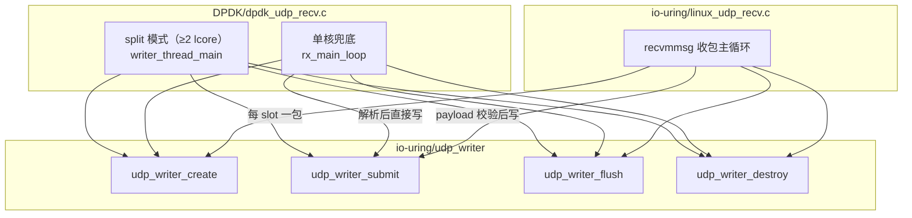
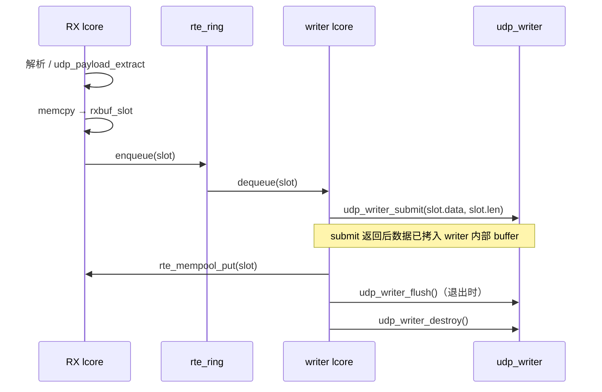
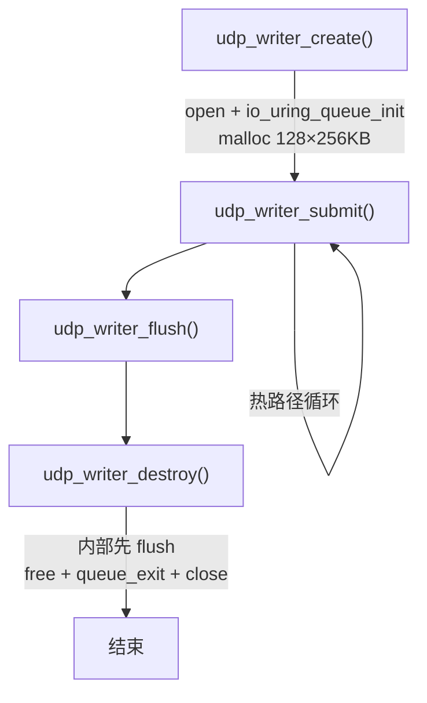
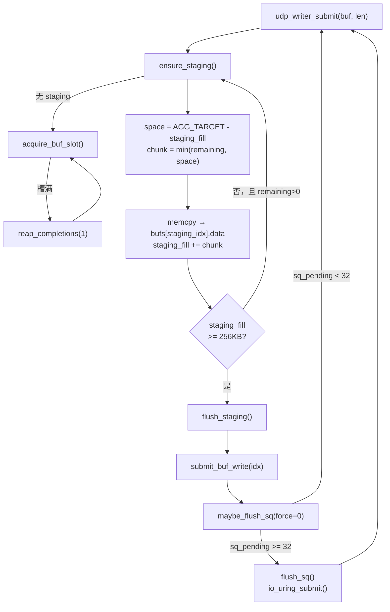
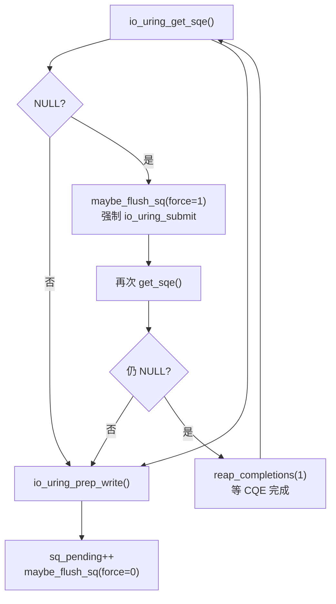
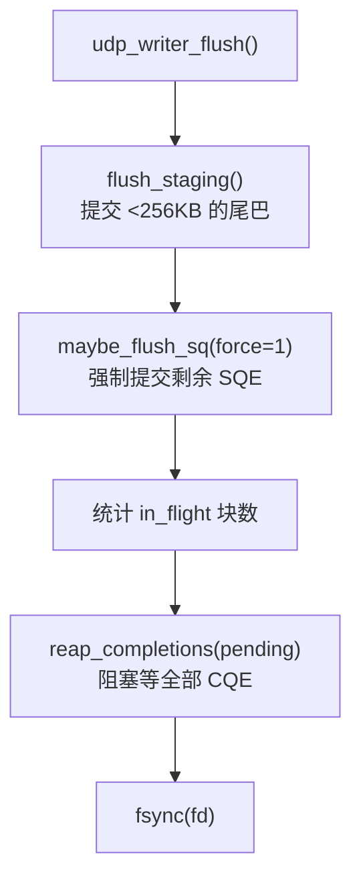
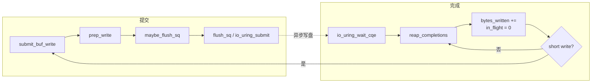
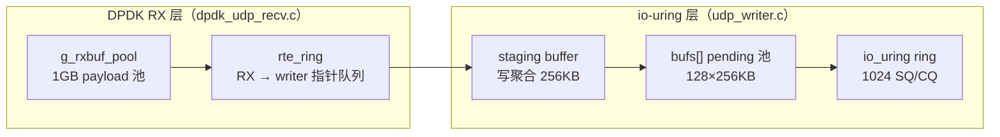
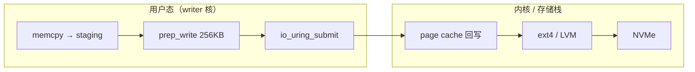
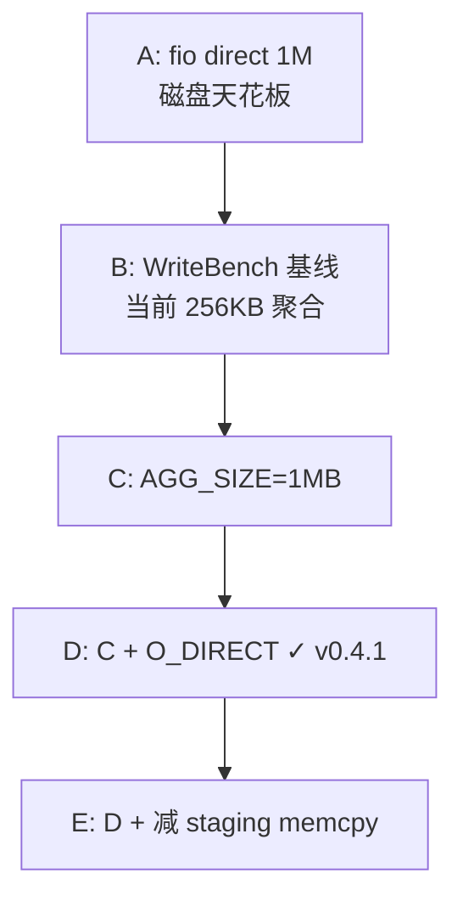

# io-uring 写盘模块（udp_writer）

共用 io_uring 异步写盘库。DPDK 收包路径与 Linux 基线（`linux_udp_recv.c`）均通过本模块落盘，保证写盘逻辑一致。

源文件：

| 文件 | 说明 |
|------|------|
| `udp_writer.h` | 公共 API 与统计结构 |
| `udp_writer.c` | io_uring 写盘实现 |
| `linux_udp_recv.c` | Linux `recvmmsg` 收包 + 本库写盘的基线程序 |

配置常量见 `include/demo_udp_config.h`。

---

## 1. 上游调用关系

### 1.1 谁在用



### 1.2 典型调用序列

所有上游路径遵循同一生命周期：

```
udp_writer_create(path, 0)
    → 循环 udp_writer_submit(writer, data, len)
    → udp_writer_flush(writer)
    → udp_writer_get_stats(writer)   // 可选
    → udp_writer_destroy(writer)
```

### 1.3 DPDK split 模式（双核）

RX 核收包、解析、校验后，把 payload 拷入 `g_rxbuf_pool` 的 slot，经 `rte_ring` 把指针交给 writer 核；writer 核专责落盘：



要点：**`udp_writer_submit` 返回即可复用 slot**，不必等磁盘 CQE；背压由 `g_rxbuf_pool` / `rte_ring` 承担。

### 1.4 Linux 基线

`linux_udp_recv.c` 在单线程内：`recvmmsg` 收包 → 剥离 8 字节 payload 头 → `udp_payload_extract` 校验 → `udp_writer_submit`。

### 1.5 公共 API 一览

| 函数 | 作用 |
|------|------|
| `udp_writer_create(path, ring_entries)` | 打开输出文件、初始化 io_uring、分配 buffer 池；`ring_entries=0` 用默认值 |
| `udp_writer_submit(w, buf, len)` | 提交一段数据写盘；内部 memcpy，调用方可立即释放 `buf` |
| `udp_writer_flush(w)` | 刷 staging 尾巴、强制 submit 剩余 SQE、等全部 CQE、`fsync` |
| `udp_writer_destroy(w)` | 内部先 `flush`，再释放资源 |
| `udp_writer_bytes_written(w)` | 只读：已通过 CQE 确认的字节数 |
| `udp_writer_get_stats(w)` | 只读：syscall / SQE / queue_full 等统计快照 |

---

## 2. 配置参数

定义于 `demo_udp_config.h`：

| 宏 | 默认值 | 含义 |
|----|--------|------|
| `UDP_WRITER_RING_ENTRIES` | 1024 | io_uring SQ/CQ 环深度；限制同时在飞 I/O 上限 |
| `UDP_WRITER_MAX_PENDING_BUFS` | 128 | 内部 `pending_buf` 槽位数 |
| `UDP_WRITER_BUF_SIZE` | 256 KB | 每个 pending buffer 的 `data` 大小；须 ≥ `AGG_SIZE` |
| `UDP_WRITER_AGG_SIZE` | 256 KB | **写聚合**目标：攒满后 `prep_write` 一个 SQE |
| `UDP_WRITER_SUBMIT_BATCH` | 32 | **批量 submit**：累计 32 个 SQE 再 `io_uring_submit()` |
| `UDP_WRITER_USE_O_DIRECT` | **1**（v0.4.1） | 1=绕过 page cache；0=普通 buffered 写 |
| `UDP_WRITER_IO_ALIGN` | **4096 B** | O_DIRECT 下 buffer/IO 块对齐（须整除 `AGG_SIZE`） |

两层优化叠加：

```
小包 (~1400B) ──memcpy──► staging buffer
         攒满 256KB ──► 1 个 prep_write SQE
         攒满 32 SQE  ──► 1 次 io_uring_submit 系统调用
```

稳态下约 **每 8 MB 数据一次 `io_uring_submit`**（32 × 256 KB）。

---

## 3. 核心数据结构

### 3.1 `struct pending_buf`（单块写缓冲）

| 字段 | 类型 | 含义 |
|------|------|------|
| `data` | `char *` | 预分配的 256 KB 数据区 |
| `len` | `size_t` | 本块待写总长度（flush_staging 时设定） |
| `done` | `size_t` | 已通过 CQE 确认写掉的字节数（支持 short write 续写） |
| `file_offset` | `off_t` | 本块在输出文件中的起始偏移 |
| `in_flight` | `int` | 已 `prep_write` 且 CQE 未完成时为 1 |

### 3.2 `struct udp_writer`（实例状态）

| 字段 | 含义 |
|------|------|
| `fd` | 输出文件描述符 |
| `ring` / `ring_entries` | io_uring 实例与队列深度 |
| `bufs[]` | 128 个 `pending_buf` 组成的在途写 buffer 池 |
| `buf_count` | 池大小（= `MAX_PENDING_BUFS`，仅记录） |
| `next_buf` | 环形分配游标，`acquire_buf_slot` 从此轮询空闲槽 |
| `write_offset` | 文件逻辑写入位置（下一块的起始 offset） |
| `staging_idx` | 当前用于**写聚合**的 `bufs[]` 下标；`-1` 表示无 staging |
| `staging_fill` | staging buffer 内已攒入的字节数 |
| `sq_pending` | 已 `prep_write` 但尚未 `io_uring_submit` 的 SQE 计数 |
| `stats` | 运行时统计（见下） |

### 3.3 `struct udp_writer_stats`

| 字段 | 含义 |
|------|------|
| `submit_count` | `io_uring_submit()` 系统调用次数 |
| `sqe_count` | `prep_write` 产生的 SQE 总数 |
| `bytes_written` | CQE 确认的实际写入字节数 |
| `queue_full_count` | buffer 槽位耗尽、需 `reap_completions` 等待的次数 |

---

## 4. 本层运行逻辑

### 4.1 生命周期



### 4.2 `udp_writer_submit` 热路径（写聚合）



**聚合核心**（`udp_writer.c` 310–318 行）：多包顺序 `memcpy` 到同一块 `bufs[staging_idx]`，攒满 256 KB 后 `flush_staging` 提交一个 write SQE。

### 4.3 `submit_buf_write` 与 SQ 背压



**`get_sqe` 失败的两类原因：**

| 原因 | 处理 |
|------|------|
| 攒批未 submit：已 `prep_write` 的 SQE 占着 SQ 环槽位 | `force=1` → `io_uring_submit` 交出内核，腾出 SQ 槽 |
| 在途 I/O 打满 ring（1024 个写未完成） | `reap_completions` 等 CQE → 释放在途名额 |

注意：**未 submit ≠ 槽位空闲**。`get_sqe` 调用即占用 SQ 环上一个槽，`io_uring_submit` 后才归还。

### 4.4 `udp_writer_flush` 收尾



### 4.5 io_uring 完成侧闭环



`reap_completions` 是资源回收枢纽：buffer 槽位不足、SQ 满、`flush_sq` 返回 `-EBUSY` 时都会调用它。

---

## 5. 内部函数分层

| 层级 | 函数 | 角色 |
|------|------|------|
| 公共 API | `udp_writer_create` | 创建实例 |
| | `udp_writer_submit` | 外部入口，逐段提交数据 |
| | `udp_writer_flush` | 刷尾巴 + 强制 submit + 等 CQE + fsync |
| | `udp_writer_destroy` | flush 后释放 |
| | `udp_writer_bytes_written` / `udp_writer_get_stats` | 只读统计 |
| 聚合层 | `ensure_staging` | 确保有 staging 槽可攒数据 |
| | `flush_staging` | staging 满或 flush 时提交一块写 |
| 资源层 | `acquire_buf_slot` | 从 128 槽池找 `in_flight==0` 且非 staging 的 buffer |
| io_uring 层 | `submit_buf_write` | `prep_write` 一个 SQE |
| | `maybe_flush_sq` | 批量攒 SQE（默认 32 个再 submit） |
| | `flush_sq` | 调用 `io_uring_submit`，`-EBUSY` 时 reap |
| | `reap_completions` | 等 CQE、更新统计、处理 short write |

---

## 6. 与上游缓冲的关系

本模块的 `bufs[]` 池与 DPDK 侧的 `g_rxbuf_pool` / `rte_ring` 是**不同层次**：



| 层次 | 背压载体 | 复用时机 |
|------|----------|----------|
| RX → writer | `rte_ring` + `g_rxbuf_pool` | `udp_writer_submit` 返回后即可 `rte_mempool_put` |
| writer 内部 | `bufs[]` + io_uring ring | CQE 完成后 `in_flight=0`，槽位可再分配 |

---

## 7. 数据流一句话

```
上游逐包 udp_writer_submit
  → staging buffer 顺序 memcpy（写聚合）
  → 攒满 256KB → flush_staging → prep_write（1 SQE）
  → 攒满 32 SQE → io_uring_submit（1 syscall）
  → 内核异步写盘 → reap_completions（CQE，槽位复用）

退出时 udp_writer_flush / destroy
  → 强制跑完上述链路中所有未完成步骤
```

---

## 8. 性能基线与瓶颈演进

### 8.1 已验证数据（v0.4.1，2026-06-18）

v0.4.0 写聚合消除小 IO/syscall 瓶颈后，v0.4.1 启用 **O_DIRECT + 4K 对齐 buffer** 绕过 page cache。详见 `docs/M_Version.md` v0.4.1。

| 场景 | 吞吐（量级） | flush+fsync | 说明 |
|------|-------------|-------------|------|
| WriteBench v0.4.0（buffered） | **~423 MB/s** | ~1.4 s | 256KB 聚合 + batch 32 |
| **WriteBench v0.4.1（O_DIRECT）** | **~1629 MB/s** | **~0.06 s** | 同聚合；**+3.85×** |
| **DPDK live 2M×1400B（v0.4.1）** | burst **~1.86 Gbps** | — | 不限速；pool peak **46**；seq_gaps **0** |
| DPDK live 2M×1400B（v0.4.0） | burst **~2.05 Gbps** | — | 发端不限速；buffered 落盘 |
| NVMe 标称顺序写 | **2000+ MB/s** | — | fio direct 1M |

WriteBench 对比（2M×1400B，3 轮均值）：

| 指标 | v0.4.0 buffered | v0.4.1 O_DIRECT |
|------|-----------------|-----------------|
| MB/s（avg） | 423.08 | **1629.48** |
| Submit 段 | ~4.9 s | ~1.6 s |
| Flush+fsync | ~1.4 s | **~0.06 s** |
| SQE / syscall | 10,682 / 334 | 10,682 / 334 |

### 8.2 为何聚合后仍远低于 NVMe 标称 2000+ MB/s

NVMe 厂商或 `fio` 报的 2000+ MB/s 通常满足：**顺序写、大块（1M+）、`O_DIRECT`、高 iodepth**，且常在裸盘或调优文件系统上测得。

当前 `udp_writer` 路径与之不同：



| 层级 | 现状 | 对吞吐的影响 |
|------|------|--------------|
| IO 大小 | 256 KB / SQE | NVMe 上 1–4 MB 往往更甜 |
| IO 模式 | **v0.4.1：`O_DIRECT`**（绕过 page cache） | v0.4.0 为 buffered；O_DIRECT 后 flush 从 ~1.4s→~60ms |
| 用户态拷贝 | 每包 `memcpy` 进 staging | 全量数据至少扫一遍内存；单核 CPU 可封顶 |
| 并发 | 单 writer 线程、单 fd、ring=1024 | 可能未吃满设备队列深度 |
| 存储栈 | 常见为 LVM + ext4 | 相对裸设备常少 20–40% |
| `fsync` | `flush` 末尾一次 | 不影响 sustained 段，但 **total 口径**会多出收尾时间 |

`queue_full` 从 ~100% 降到 ~0.5% 说明：**主要不再是「等 CQE 等到死」**，当前瓶颈更像是 **CPU memcpy + page cache 路径 + IO 尺寸 + 存储栈** 的综合上限。

### 8.3 与端到端的关系

若工程上已确认 **收包是主瓶颈**（而非写盘），把 writer 从 500 MB/s 提到 1500 MB/s **端到端可能不涨**；但仍有价值：

- 降低 `bufpool_peak` / ring 背压，减少丢包 margin
- burst 后 writer 排空更快，缩短 total 时间
- 为更高速发端预留 headroom

**建议分开测两条上限：**

| 工具 | 测什么 |
|------|--------|
| `WriteBench/` | 纯 `udp_writer` 落盘上限（与线上一致实现） |
| `nowrite_demo/` | 纯 RX/解析上限 |
| `fio` | 同盘、同挂载点的设备/FS 天花板 |

---

## 9. 进一步优化方向

按 **性价比 / 改动量** 排序。实施前先用 §8.3 的工具定标尺，避免优化非瓶颈路径。

### 9.1 P0：测定真上限（必做）

在同一块盘、同一挂载点跑 `fio`，与 WriteBench 对比：

```bash
# 接近设备顺序写上限（buffered 无关）
sudo fio --name=seqwrite --filename=/path/to/testfile --rw=write \
  --bs=1M --size=4G --iodepth=32 --direct=1 --numjobs=1

# 接近当前 udp_writer（256KB buffered）
sudo fio --name=bufwrite --filename=/path/to/testfile --rw=write \
  --bs=256k --size=4G --iodepth=32 --direct=0
```

| fio 结果 | 含义 |
|----------|------|
| direct 1M 也只有 600–800 MB/s | 盘 / RAID / LVM / FS 上限在此，应用层难破 |
| fio 2 GB/s+，WriteBench ~500 | 应用路径（page cache、memcpy、IO 尺寸）仍有空间 |

WriteBench 一键压测：

```bash
cd /home/cics/HMH/WriteBench
bash run_write_bench.sh --count 2000000 --rounds 3
```

关注：`MB/s`、`submit_count`、`sqe_count`、`queue_full_count`、Submit / Flush / Total 分段耗时。

### 9.2 P1：加大写聚合（改动小）

在 `demo_udp_config.h` 调整：

| 宏 | 建议尝试 | 预期 |
|----|----------|------|
| `UDP_WRITER_AGG_SIZE` | 256 KB → **1 MB** | SQE 数再降 ~4×，更接近 NVMe 甜区 |
| `UDP_WRITER_BUF_SIZE` | 同步 ≥ `AGG_SIZE` | 须保持 `BUF_SIZE >= AGG_SIZE` |
| `UDP_WRITER_SUBMIT_BATCH` | 32 → **64 / 128** | 进一步减 syscall（在 ring=1024 内） |

先在 WriteBench A/B，再合入 UDP_DPDK。

### 9.3 P2：`O_DIRECT` + 对齐 buffer（**v0.4.1 已完成**）

当前 `udp_writer_create` 在 `UDP_WRITER_USE_O_DIRECT=1` 时：

```c
w->fd = open(path, O_WRONLY | O_CREAT | O_TRUNC | O_DIRECT, 0644);
/* pending_buf.data 经 posix_memalign(4096) 分配 */
/* 尾部不足 4K：zero-pad → write → ftruncate(logical_size) */
```

WriteBench 2M×3 轮：**423 → 1629 MB/s**（+3.85×）；pcap E2E 10k 包 **PASS**。

可选进阶：`io_uring_register_buffers` + `IORING_OP_WRITE_FIXED`（尚未实施）。

### 9.4 P3：减少 memcpy（改动中～大）

全链路仍存在 **payload → staging** 的拷贝（DPDK split 还有 **slot → staging**）：

| 方向 | 说明 |
|------|------|
| 零拷贝 submit | `prep_write` 直接指向调用方 buffer，生命周期绑到 CQE |
| mbuf / slot 直交 writer | RX 侧去掉 slot `memcpy`，writer `submit` 后再释放 mbuf |
| WriteBench 对齐源 buffer | 预分配 4K 对齐内存，为 `O_DIRECT` / fixed buffer 铺路 |

CPU 内存带宽省下来后，500→800+ MB/s 有时比再加聚合更明显。

### 9.5 P4：io_uring 进阶（P1–P3 仍不满设备时）

| 手段 | 作用 |
|------|------|
| `IORING_SETUP_SQPOLL` | 内核轮询 SQ，减 syscall 与唤醒开销 |
| `io_uring_register_files` | 固定 fd，降 per-op 成本 |
| 提高 `UDP_WRITER_RING_ENTRIES` + 更深 in_flight | 喂饱 NVMe 队列 |
| 多线程 / 多文件 stripe | 单核 writer 喂不饱设备时；单源流需注意 seq 块分发 |

### 9.6 P5：存储与部署（运维向）

- 输出文件放 **独立 NVMe 分区**，避免与系统盘 LVM 争用
- 评估 ext4 → **XFS**（大顺序写有时更稳）
- 长跑注意 **TLC 掉速 / 温控降频**（短跑 WriteBench 与长跑 live 差很多）
- `flush` 末尾 `fsync`：若业务允许异步落盘，可单独统计 flush 时间，不把 `fsync` 混入 burst 口径

### 9.7 P6：上游 RX 循环（与写盘正交）

写盘非瓶颈时，优先抠 RX 侧（见 `DPDK/dpdk_udp_recv.c` 主循环）：

| 方向 | 说明 |
|------|------|
| mbuf 直交 writer | 去掉 slot `memcpy` |
| `rte_mbuf_mtod` 快路径 | 避免 `rte_pktmbuf_read` 落到 `pkt_buf` |
| `mempool_get_bulk` + `enqueue_bulk` | 降 per-packet 固定开销 |
| SPSC 字节环 | 改善跨包内存局部性 |

split vs run-to-completion：写盘不阻塞 RX 时，split 的额外拷贝可能不划算；见 §6 与工程 profiling 决策。

### 9.8 建议实验矩阵



| 实验 | 改动 | 观察指标 |
|------|------|----------|
| A | `fio` direct 1M | 设备/FS 上限 |
| B | 当前配置 | 基线 MB/s、syscall、queue_full |
| C | `AGG_SIZE=1MB` | MB/s、SQE 数 |
| D | C + `O_DIRECT` | WriteBench **1629 MB/s**；live 2M **COMPLETE**（burst ~1.86 Gbps，pool peak 46） |
| E | D + 零拷贝 / 少拷贝 | CPU%、MB/s |

**经验预期（LVM + buffered 写）：**

| 目标 | 可行性 |
|------|--------|
| 500 → 700–900 MB/s | 加大聚合 + 调 submit batch，较现实 |
| 800–1200 MB/s | 通常需 `O_DIRECT` + 1MB+ IO |
| 1500+ MB/s | 裸盘/好 FS + 更深队列 + 可能减 memcpy |
| 2000+ MB/s | 接近 fio 理想条件；与「逐包 1400B 业务模型」本身存在张力 |

### 9.9 版本路线图对照

| 优先级 | 事项 | 状态 |
|--------|------|------|
| — | 256KB 写聚合 + 批量 submit 32 | **已完成**（v0.4.0） |
| P1 | **`O_DIRECT` + 对齐 buffer** | **已完成**（v0.4.1） |
| P1 | 更大聚合（1MB）、`io_uring_register_buffers` | 1MB WriteBench 仅 +3.5%；register_buffers 待做 |
| P2 | 同步更新 `PERF_DATA.md`、`UDP_STATUS.md` | **已完成**（v0.4.1） |
| P2 | 多核 RSS / 每核 writer（多流场景） | 单流千兆已非瓶颈时优先级低 |

---

## 10. 构建与运行

写盘库由 DPDK / Linux 收包程序的 Makefile 一并编译链接，无独立可执行目标。

Linux 基线可直接运行 `linux_udp_recv`（参见项目根目录 `UDP_DPDK` 文档）。DPDK 路径见 `DPDK/dpdk_udp_recv.c` 头部注释中的 EAL 参数示例。

纯写盘压测使用 sibling 项目 **`WriteBench/`**（`udp_writer` 逻辑与本文档实现保持一致）。
